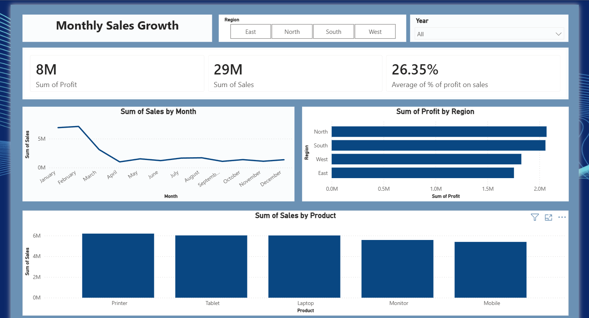

Sales Data Analytics Pipeline & Dashboard
End-to-end analytics project: raw Excel/CSV sales data → Python cleaning → MySQL → SQL analysis → Power BI dashboard.

Business Problem
Sales data kept in Excel/CSV files is often duplicated and inconsistent, which makes it hard to track sales, profitability and regional performance. This project turns raw order data into a clean MySQL database and an interactive Power BI dashboard.
Dataset
Sample sales data, 682 orders (Jan 2023 – Mar 2026) across 4 regions (North, South, East, West), 5 products (Printer, Laptop, Tablet, Monitor, Mobile) and 10 customers.
Columns: `Order_ID, Order_Date, Customer, Region, Product, Sales, Cost` (+ derived `Profit, Year, Month`).
Key Findings
Total Sales ₹29.2M, Total Profit ₹7.7M, Average Profit % 26.35% across 682 orders.
North (₹2.07M) and South (₹2.06M) are the top profit regions, together giving ~53% of total profit. East earns the least profit (22.8% share) but has the highest margin (27.2%), so its gap comes from lower sales volume, not weak pricing.
Printer is the top product by sales (₹6.19M) and profit (₹1.68M, 27.1% margin). Mobile is the lowest in both sales (₹5.39M) and profit.
Profit margins are similar across products (25.9%–27.1%), so growth is driven by sales volume rather than margin differences.
The best-performing product differs by region: Laptop in East and South, Printer in North, Tablet in West.
Top customer by profit: Rohit (₹0.89M).
Workflow
Clean (Python/Pandas) – removed 20 duplicate rows and 18 rows with invalid/missing dates (520 → 482 orders), converted date types, created `Profit`, `Year`, `Month` → `sales_cleaned.csv`
Add new data – appended 200 new 2026 orders to the same table
Store (MySQL) – database `salesdb`, table `sales_data` (682 records)
Analyse (SQL) – KPIs, region/product analysis, month-over-month growth (window functions), top customers, RANK per region → `sql/sales_analysis.sql`
Visualise (Power BI) – KPI cards, monthly sales trend, profit by region, sales by product, Region and Year filters
Data Notes
The dataset has no 2025 orders and only 7 orders in March 2026, so month-wise trends should be read with this in mind.
Jan–Feb 2026 have ~3x the monthly orders of earlier months, which affects the "Sales by Month" chart when all years are selected. Use the Year filter to compare one year at a time.
Repository Structure
```
├── notebooks/
│   ├── 01_data_cleaning_2023_24.ipynb
│   └── 02_append_2026_data.ipynb
├── sql/sales_analysis.sql
├── dashboard/sales_dashboard.pbix
├── data/ (sales_raw_500.xlsx, sales_raw_new_2026.csv, sales_cleaned.csv)
├── Sales_dashboard.png
└── README.md
```
How to Run
`pip install pandas sqlalchemy pymysql openpyxl jupyter`
Set your MySQL password as an environment variable: `MYSQL_PASSWORD`
Run the notebooks in order (they create `salesdb` and load `sales_data`)
Run `sql/sales_analysis.sql` in MySQL 8
Open `dashboard/sales_dashboard.pbix` in Power BI Desktop
Tools
Python · Pandas · MySQL · SQL (Window Functions, CTEs) · Power BI · Excel
Author
Tejas Kadam – LinkedIn
